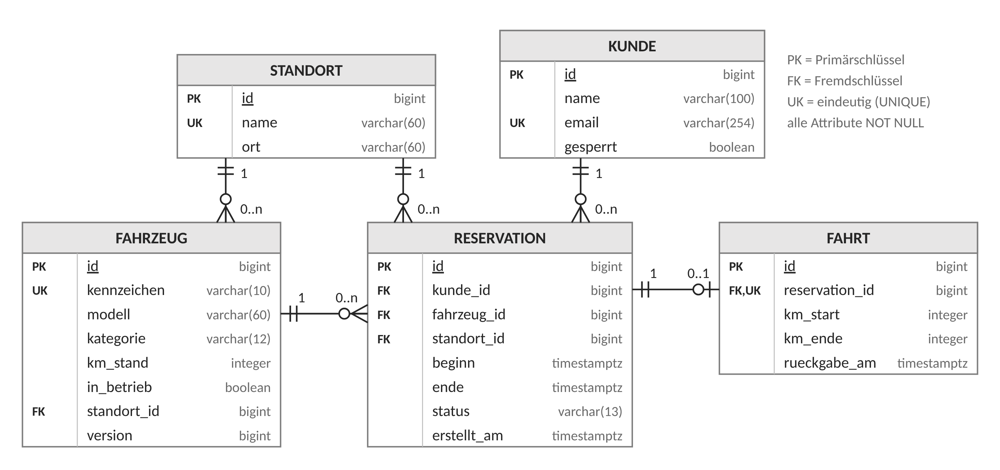

# Seeland Mobil

Carsharing-Verwaltung für einen regionalen Anbieter im Seeland: Fahrzeuge, Kunden, Reservationen,
Fahrtabschluss und Nutzungsauswertung als REST-API mit Spring Boot und PostgreSQL.
Projektarbeit Database Development, HFTM.

## Schnellstart

Voraussetzungen: Java 21 und Docker.

Datenbank starten:

```bash
docker compose up -d
```

Anwendung starten: in IntelliJ `SeelandMobilApplication` oder `mvn spring-boot:run`.
Beim Start baut Flyway das Schema auf (`src/main/resources/db/migration`). Die API läuft auf `http://localhost:8080`.

Tests: in IntelliJ Rechtsklick auf `src/test/java` → *Run 'All Tests'* oder `mvn test`.
Die Tests starten mit Testcontainers ein eigenes PostgreSQL 16; Docker muss laufen.

API ausprobieren: `http/requests.http` im HTTP Client von IntelliJ von oben nach unten ausführen
(frische Datenbank). Gleichzeitige Reservationen live zeigen:

```bash
scripts/demo-konflikt.sh <fahrzeugId> <kundeIdA> <kundeIdB>
```

Eine Antwort ist 201, die andere 409.

## Testdaten

Nachdem das Schema aufgebaut ist (Anwendung einmal gestartet):

```bash
docker compose exec -T db psql -U seeland -d seeland -v ON_ERROR_STOP=1 < scripts/testdaten.sql
```

Erzeugt 8 Standorte, 240 Fahrzeuge, 20'000 fiktive Kunden, 121'880 Reservationen (Oktober 2024 bis
Anfang 2027, Stichtag 1.10.2026) und rund 92'000 Fahrten. Jeder Lauf ersetzt die bestehenden Daten und
erzeugt exakt dieselben Datensätze. Danach die Anwendung neu starten, damit der Cache der
Standortauswertung keine Werte von vorher enthält.

## API

| Methode | Pfad | Anf. |
|---|---|---|
| GET | `/api/standorte` | – |
| POST | `/api/fahrzeuge` | A1 |
| GET | `/api/fahrzeuge/{id}` | A1 |
| PUT | `/api/fahrzeuge/{id}` | A1 |
| POST | `/api/fahrzeuge/{id}/ausser-betrieb` | A1 |
| POST | `/api/kunden` | A2 |
| GET | `/api/kunden/{id}` | A2 |
| PUT | `/api/kunden/{id}` | A2 |
| POST | `/api/kunden/{id}/sperren` | A2 |
| POST | `/api/reservationen` | A3 |
| GET | `/api/reservationen/{id}` | A3 |
| POST | `/api/reservationen/{id}/stornieren` | A3 |
| GET | `/api/kunden/{id}/reservationen?status=&seite=&groesse=` | A4 |
| POST | `/api/reservationen/{id}/abschliessen` | A5 |
| GET | `/api/fahrzeuge/verfuegbar?von=&bis=&standortId=&kategorie=&seite=&groesse=` | A6 |
| GET | `/api/auswertungen/standorte?von=&bis=` | A7 |
| GET | `/api/auswertungen/fahrzeuge?von=&bis=&standortId=` | A7 |

Fehler kommen als Problem Details (RFC 9457): 400 ungültige Eingabe (mit `fehler` je Feld),
404 unbekannte ID, 409 Konflikt mit einer Geschäftsregel oder dem aktuellen Datenbestand.
Zeitpunkte sind ISO 8601 mit Zeitzone, Zeiträume halboffen `[von, bis)`.

## Fachanforderungen und Nachweise

Jeder Prüffall aus dem Projektsteckbrief hat einen automatisierten Test gegen PostgreSQL.

| Anf. | Prüffall | Test |
|---|---|---|
| A1 | Doppeltes Kennzeichen → 409 | `FahrzeugApiTest.doppeltesKennzeichenGibt409` |
| A1 | Standortwechsel mit offener Reservation → 409 | `FahrzeugApiTest.standortwechselMitOffenerReservationGibt409` |
| A1 | Ausserbetriebnahme mit offener Reservation → 409 | `FahrzeugApiTest.ausserBetriebMitOffenerReservationGibt409` |
| A1 | Ausser Betrieb: nicht in A6 | `VerfuegbarkeitApiTest.ausserBetriebWirdNieGelistet` |
| A1 | Ausser Betrieb: Reservation → 409 | `ReservationApiTest.fahrzeugAusserBetriebGibt409` |
| A1 | Veraltete Version → 409 | `FahrzeugApiTest.veralteteVersionGibt409` |
| A2 | «Lea.Gerber@Example.ch» nach «lea.gerber@example.ch» → 409 | `KundeApiTest.emailIstUnabhaengigVonGrossKleinschreibungEindeutig` |
| A2 | Reservation eines gesperrten Kunden → 409 | `ReservationApiTest.gesperrterKundeGibt409` |
| A3 | 10–14 und 12–16 → zweite 409 | `ReservationApiTest.ueberschneidungGibt409` |
| A3 | dasselbe gleichzeitig → eine 409 | `ReservationNebenlaeufigkeitTest.gleichzeitigeUeberschneidendeReservationWartetUndScheitert` |
| A3 | 10–14 und 14–16 → beide 201 | `ReservationApiTest.direktAnschliessenderZeitraumIstErlaubt` |
| A3 | Nach Storno von 10–14 ist 12–16 möglich | `ReservationApiTest.stornoGibtDenZeitraumFrei` |
| A3 | Storno nach Beginn → 409 | `ReservationApiTest.stornoNachBeginnGibt409` |
| A3 | Ende ≤ Beginn → 400 | `ReservationApiTest.endeVorOderGleichBeginnGibt400` |
| A4 | Seiten 1–3 lückenlos, ohne Duplikate, Reihenfolge stabil | `KundenReservationApiTest.seitenEinsBisDreiSindLueckenlosOhneDuplikateUndStabil` |
| A4 | SQL zeigt Filter, ORDER BY und Seitenbegrenzung in der Datenbank | `ReservationslisteAbfragenTest.filterSortierungUndSeitenbegrenzungLaufenInDerDatenbank` |
| A5 | Erfolg: Fahrt, Status und km-Stand geändert | `FahrtAbschlussTest.abschlussFuehrtAlleDreiAenderungenDurch` |
| A5 | km-Ende < km-Stand → 400, nichts geändert | `FahrtAbschlussTest.kmEndeKleinerAlsKmStandRolltAuchDenStatusZurueck` |
| A5 | Zweiter Abschluss → 409 | `FahrtAbschlussTest.zweiterAbschlussGibt409` |
| A6 | Reservation 10–14: fehlt bei 13–15 | `VerfuegbarkeitApiTest.ueberschneidendeReservationSchliesstAus` |
| A6 | … erscheint bei 14–16 | `VerfuegbarkeitApiTest.direktAnschliessenderZeitraumIstFrei` |
| A7 | Kontrollierter Datensatz mit bekannten Summen → exakt | `NutzungRepositoryTest.jeStandortExakteSummen`, `.jeFahrzeugMitAuslastung` |
| A7 | Standorte und Fahrzeuge ohne Fahrt mit 0 | `NutzungRepositoryTest.standorteOhneFahrtErscheinenMitNull` |
| A7 | Wiederholte Abfrage ohne SQL aus dem Cache | `NutzungCacheTest.zweiterAufrufKommtOhneSqlAusDemCache` |
| A7 | Nach A5 sofort der neue Wert | `NutzungCacheTest.nachFahrtabschlussSofortDerNeueWert` |

Weitere Fälle (400, 404, Filter, Grenzen) stehen in denselben Testklassen.
Die Tests liegen unter `src/test/java/ch/hftm/seelandmobil/`.

## Technische Nachweise T1–T12

| Nr | Pflicht | Umsetzung | Nachweis |
|---|---|---|---|
| T1 | Eigenes relationales Modell | 5 Tabellen, Schlüssel, CHECK, UNIQUE, Exclusion-Constraint; ER-Diagramm unten | `SchemaConstraintsTest` prüft jede Regel per SQL direkt in der Datenbank |
| T2 | Flyway: Aufbau ab leerer DB und Folgemigration | V1–V6 Grundschema; V7 fügt den Abholstandort hinzu und füllt ihn aus bestehenden Daten; V8 View; V9 Index | `MigrationTest`, `AbholstandortMigrationTest` (DB auf V6 mit Daten → migrieren) |
| T3 | Spring Boot, JPA, getrennte DTOs, Daten verwalten | Entities mit `@ManyToOne(fetch = LAZY)` und `@OneToOne`; Records als Request/Response; Controller → Service → Repository; erfassen, lesen, ändern, deaktivieren (ausser Betrieb, sperren, stornieren) | `EntityMappingTest`, `FahrzeugApiTest`, `KundeApiTest`, `http/requests.http` |
| T4 | Atomare Operation, Rollback nach Schreibzugriff | A5 in einer Transaktion: bedingtes UPDATE der Reservation → INSERT Fahrt (CHECK in der DB) → UPDATE km-Stand mit `version` | `FahrtAbschlussTest`: Erfolg, Rollback nach Schritt 1, Versionskonflikt in Schritt 3 |
| T5 | Konkurrierende Zugriffe | Exclusion-Constraint gegen Doppelbuchungen; Zeilensperren zwischen A1 und A3; `@Version` gegen Lost Updates | `ReservationNebenlaeufigkeitTest` (zwei Transaktionen, die zweite wartet nachweislich), `FahrzeugApiTest.veralteteVersionGibt409`, `FahrtAbschlussTest.gleichzeitigeFahrzeugAenderungRolltAllesZurueck` |
| T6 | JPQL-/DTO-Projektion, JDBC mit JOIN und Aggregation, View | A6: `select new VerfuegbaresFahrzeug(…)` mit `not exists`; A7: `NamedParameterJdbcTemplate`, `LEFT JOIN`, `GROUP BY`, ausschliesslich über die View `v_fahrt_nutzung` | `VerfuegbarkeitApiTest`, `NutzungRepositoryTest`, `FahrtNutzungViewTest` |
| T7 | Filter, stabile Sortierung, Pagination in der DB | A4: Status-Filter, `order by beginn desc, id desc`, Seite (Standard 20, max. 100); A6: nach Kennzeichen, seitenweise | `KundenReservationApiTest`, `ReservationslisteAbfragenTest`, `VerfuegbarkeitApiTest.seitenweiseNachKennzeichenSortiert` |
| T8 | Integrationstests gegen PostgreSQL | Testcontainers mit `postgres:16-alpine`, kleine Testdaten je Test | alle Tests unter `src/test/java` |
| T9 | Mindestens 100'000 Datensätze, reproduzierbar | `scripts/testdaten.sql`: 121'880 Reservationen; Zufallswerte aus md5 fester Schlüssel statt `random()` | `docs/performance.md` |
| T10 | EXPLAIN ANALYZE, Index, vorher/nachher | A4-Abfrage; V9 `ix_reservation_kunde_beginn`; 5 Läufe, Median | `scripts/messung-a4.sql`, `docs/performance.md`, `KundenIndexTest` |
| T11 | ORM-Ladeverhalten, N+1 | A4 als Entity-Liste 12/30/60 Abfragen bei Seitengrösse 5/20/50, mit Fetch Join immer 2 | `ReservationslisteAbfragenTest.entityListeLaedtProZeileNachFetchJoinNicht` |
| T12 | Cache und Aktualität | Standortauswertung (A7), Schlüssel `(von, bis)` als Zeitpunkte; geleert nach dem COMMIT jedes Fahrtabschlusses | `NutzungCacheTest`: erster Zugriff, Treffer ohne SQL, nach Änderung, Rollback, Abfrage vor dem COMMIT |

## Datenmodell



| Version | Migration |
|---|---|
| V1–V5 | Grundschema: `standort`, `fahrzeug`, `kunde`, `reservation` (Exclusion-Constraint gegen Überschneidungen), `fahrt` |
| V6 | Vorgegebene Standorte |
| V7 | Abholstandort in `reservation`; bestehende Reservationen übernehmen den Standort ihres Fahrzeugs |
| V8 | View `v_fahrt_nutzung` mit allen abgeschlossenen Fahrten |
| V9 | Index `ix_reservation_kunde_beginn` für die Reservationsliste eines Kunden (A4) |

## Performance

Messungen zu Datenmenge, Index, N+1 und Cache: [docs/performance.md](docs/performance.md).
Messung wiederholen (Testdaten geladen, Anwendung nicht in Betrieb):

```bash
docker compose exec -T db psql -U seeland -d seeland < scripts/messung-a4.sql
```

## Projektstruktur

```
src/main/java/ch/hftm/seelandmobil/
  standort/      Standorte (nur lesen)
  fahrzeug/      A1 Fahrzeuge, A6 Verfügbarkeitssuche
  kunde/         A2 Kunden
  reservation/   A3 Reservationen, A4 Liste je Kunde, A5 Fahrtabschluss
  auswertung/    A7 Nutzungsauswertung (JDBC, Cache)
  common/        Fehlerbehandlung, Seiten, Konfiguration
src/main/resources/db/migration/   Flyway V1–V9
scripts/         Testdaten, Messung, Konflikt-Demo
http/            Beispielaufrufe
docs/            ER-Diagramm, Performance
```
