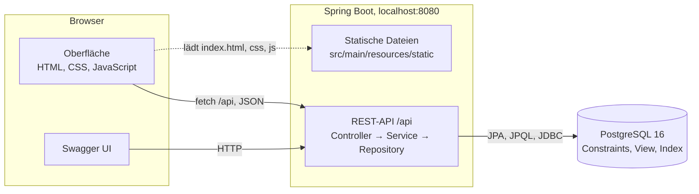
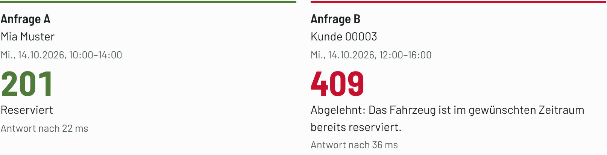

# Seeland Mobil

Carsharing-Verwaltung für einen regionalen Anbieter im Seeland: Fahrzeuge, Kunden, Reservationen,
Fahrtabschluss und Nutzungsauswertung. REST-API mit Spring Boot und PostgreSQL, dazu eine Oberfläche im Browser.

Projektarbeit Database Development, HFTM · Mohamed Rumy · Dozent: Simon Erhardt
Projektsteckbrief: [aktualisierte Fassung](docs/projektsteckbrief.pdf) (Stand der Abgabe) ·
[eingereichte Fassung vom 07.10.2026](docs/projektsteckbrief-eingereicht.pdf)

## Für die Bewertung

| Schritt | Was | Abschnitt |
|---|---|---|
| 1 | Voraussetzungen prüfen | [Voraussetzungen](#voraussetzungen) |
| 2 | Datenbank und Anwendung starten | [Starten](#starten) |
| 3 | Testdaten laden (unter einer Minute) | [Testdaten](#testdaten) |
| 4 | Fachfunktionen in der Oberfläche durchspielen (28 Schritte) | [docs/pruefanleitung.md](docs/pruefanleitung.md) |
| 5 | Automatisierte Tests ausführen (95 Tests) | [Tests](#tests) |
| 6 | Nachweise je Kriterium des Bewertungsrasters | [Nachweise je Kriterium](#nachweise-je-kriterium) |

## Fachliche Anforderungen

| Nr | Anforderung |
|---|---|
| A1 | Fahrzeuge verwalten: eindeutiges Kennzeichen; Standortwechsel und Ausserbetriebnahme nur ohne offene Reservationen; Änderungen mit veraltetem Stand werden abgelehnt |
| A2 | Kunden verwalten: E-Mail eindeutig, unabhängig von Gross- und Kleinschreibung; gesperrte Kunden können nicht reservieren |
| A3 | Reservieren und stornieren: Zeiträume desselben Fahrzeugs überschneiden sich nie, auch bei gleichzeitigen Anfragen; Storno nur vor Beginn |
| A4 | Reservationen eines Kunden: nach Status filtern, neueste zuerst, seitenweise |
| A5 | Fahrt abschliessen: Fahrt anlegen, Reservation abschliessen, km-Stand nachführen, vollständig oder gar nicht |
| A6 | Freie Fahrzeuge für einen Zeitraum suchen, optional nach Standort und Kategorie |
| A7 | Nutzung je Abholstandort und je Fahrzeug: Fahrten, Nutzungsstunden, Kilometer und Auslastung |

Abgrenzung: Standorte fest vorgegeben, keine Anmeldung, keine Tarife oder Zahlung.

## Voraussetzungen

| Was | Version | Hinweis |
|---|---|---|
| JDK | 21 | `java -version` |
| Docker Desktop | gestartet | Datenbank (`compose.yaml`) und Integrationstests (Testcontainers) |
| IntelliJ IDEA oder Maven | Maven 3.9 oder neuer | IntelliJ bringt Maven mit; das Repository enthält keinen Maven Wrapper |
| Browser | aktuelles Chrome, Edge, Firefox oder Safari | |
| Freie Ports | 5432 und 8080 | Läuft lokal bereits ein PostgreSQL auf 5432, dieses vorher beenden |

Internet braucht es nur beim ersten Start (Maven-Abhängigkeiten, Image `postgres:16-alpine`).

## Starten

```bash
docker compose up -d      # PostgreSQL 16 auf localhost:5432, Datenbank, Benutzer und Passwort: seeland
mvn spring-boot:run       # oder in IntelliJ SeelandMobilApplication starten
```

In IntelliJ: Projektordner öffnen (wird als Maven-Projekt erkannt), als SDK Java 21 wählen,
`src/main/java/ch/hftm/seelandmobil/SeelandMobilApplication.java` ausführen.
Beim Start baut Flyway das Schema auf (V1–V9, `src/main/resources/db/migration`). Danach:

| Adresse | Inhalt |
|---|---|
| http://localhost:8080 | Oberfläche |
| http://localhost:8080/swagger-ui.html | Swagger UI: alle Endpunkte, ausführbar mit «Try it out» |
| http://localhost:8080/v3/api-docs | OpenAPI-Beschreibung |
| `http://localhost:8080/api/…` | REST-API |

Ohne Testdaten enthält die Datenbank nur die 8 Standorte aus V6. Beenden: Anwendung stoppen und
`docker compose down` (Daten bleiben erhalten) oder `docker compose down -v` (Datenbank löschen).

## Testdaten

Nachdem die Anwendung einmal gestartet wurde (Schema vorhanden):

```bash
docker compose exec -T db psql -U seeland -d seeland -v ON_ERROR_STOP=1 < scripts/testdaten.sql
```

In Windows PowerShell (kennt `<` nicht):

```powershell
docker compose cp scripts/testdaten.sql db:/tmp/testdaten.sql
docker compose exec db psql -U seeland -d seeland -v ON_ERROR_STOP=1 -f /tmp/testdaten.sql
```

Danach die Anwendung neu starten, damit der Cache der Standortauswertung keine Werte von vorher enthält.
Jeder Lauf ersetzt alle Daten ausser den Standorten und erzeugt exakt dieselben Datensätze mit denselben IDs.
Damit lässt sich der Ausgangszustand nach der Prüfung jederzeit wiederherstellen.

| Daten | Umfang |
|---|---|
| Standorte | 8: Biel Bahnhof, Biel Bözingen, Lyss Zentrum, Nidau, Pieterlen, Aarberg, Ins, Büren a.A. |
| Fahrzeuge | 240, `BE 100001` bis `BE 100240` |
| Kunden | 20'000 fiktive, «Kunde 00001» bis «Kunde 20000», `kunde00001@example.test` usw.; jeder 97. ist gesperrt |
| Reservationen | 121'880 von Oktober 2024 bis März 2027. Stichtag 1.10.2026: davor abgeschlossen (85 %) oder storniert, danach offen (aktiv) oder storniert |
| Fahrten | 91'799, eine je abgeschlossene Reservation |

Verteilung: Biel Bahnhof hat 70 Fahrzeuge, Biel Bözingen und Lyss je 40, die übrigen fünf Standorte je 18; grössere
Standorte sind stärker ausgelastet. Die Kunden sind stark ungleich verteilt: Median 4 Reservationen, Maximum 2'314.
So zeigen Filter, Seiten und Auswertungen sowohl kleine als auch grosse Ergebnismengen.

Kunden mit Besonderheiten:

| Kunde | Besonderheit |
|---|---|
| Kunde 00001 | 2'314 Reservationen: Blättern und Filtern |
| Kunde 00097 | gesperrt |
| Kunde 11459 | eine laufende Reservation: `BE 100064`, Biel Bahnhof, ab 6.10.2026 (ID 108809) |
| Kunde 11474 | laufende Reservation ID 108854: Fahrtabschluss in `http/requests.http` |
| Kunde 16729 | laufende Reservation ID 108214: Storno nach Beginn in Swagger UI |

## Oberfläche

Laut Projektsteckbrief genügt die API; die Oberfläche ist eine freiwillige Ergänzung, damit sich alle
Fachfunktionen ohne Werkzeuge prüfen lassen. Sie enthält keine eigenen Geschäftsregeln: Jede Aktion ist ein Aufruf
der REST-API, und Fehler zeigt sie so an, wie die API sie liefert, mit HTTP-Status und Meldung.



| Aspekt | Umsetzung |
|---|---|
| Auslieferung | Spring Boot liefert `src/main/resources/static` auf demselben Port wie die API aus. Kein Framework, kein npm, kein Build |
| Navigation | `js/app.js` wählt die Ansicht anhand der Adresse (`#/buchen`, `#/reservationen?kunde=11459` usw.) und lädt das Modul aus `js/ansichten/` |
| Datenzugriff | `js/api.js` ruft `/api/…` mit `fetch` auf; Antworten 4xx und 5xx werden zu Fehlern mit Status und Problem Details |
| Anzeige | `js/dom.js` baut die Elemente; Texte aus der Datenbank werden immer als Text eingefügt, nie als HTML |
| Kundenwahl | `js/kundenwahl.js` sucht über `GET /api/kunden?suche=` in Name und E-Mail; ein leeres Feld zeigt die ersten Kunden |
| Bestätigung | «Stornieren», «Sperren» und «Ausser Betrieb nehmen» führen erst beim zweiten Klick aus («Wirklich …?») |
| Schrift | Barlow liegt lokal unter `static/fonts` (SIL Open Font License 1.1), die Oberfläche braucht kein Internet |

| Bereich | Adresse | Inhalt | Aufrufe | Anf. |
|---|---|---|---|---|
| Buchen | `#/buchen` | Freie Fahrzeuge suchen und reservieren; «Gleichzeitig buchen» schickt zwei überlappende Anfragen gleichzeitig | `GET /api/fahrzeuge/verfuegbar`, `POST /api/reservationen` | A6, A3 |
| Reservationen | `#/reservationen` | Reservationen eines Kunden nach Status und seitenweise; Storno vor Beginn, Fahrtabschluss ab Beginn | `GET /api/kunden/{id}/reservationen`, `POST …/stornieren`, `POST …/abschliessen` | A4, A3, A5 |
| Fahrzeuge | `#/fahrzeuge` | Liste je Standort; erfassen, ändern (mit Version), ausser Betrieb nehmen | `GET` und `POST /api/fahrzeuge`, `PUT /api/fahrzeuge/{id}`, `POST …/ausser-betrieb` | A1 |
| Kunden | `#/kunden` | Suchen, erfassen, ändern, sperren | `GET` und `POST /api/kunden`, `PUT /api/kunden/{id}`, `POST …/sperren` | A2 |
| Nutzung | `#/auswertung` | Monat je Abholstandort mit Fahrzeugbestand und Auslastung, je Fahrzeug mit Auslastung; die Serverzeit aus dem Header `Server-Timing` zeigt Cache-Treffer | `GET /api/auswertungen/standorte`, `GET /api/auswertungen/fahrzeuge` | A7 |

«Gleichzeitig buchen» ([Prüfanleitung](docs/pruefanleitung.md) Schritt 15): Beide Anfragen sehen das Fahrzeug als frei, der Exclusion-Constraint
lässt nur eine zu.



## Prüfanleitung

[docs/pruefanleitung.md](docs/pruefanleitung.md) führt in 28 Schritten durch alle Fachfunktionen A1–A7 in der Oberfläche,
jeweils mit dem erwarteten Ergebnis. Dazu kommen die Fälle, die nur über Swagger UI oder die Tests prüfbar sind,
weil die Oberfläche sie gar nicht erst zulässt (zum Beispiel ein Storno nach Beginn).

Beispielaufrufe für alle Anforderungen: `http/requests.http` im HTTP Client von IntelliJ, nach dem Laden der Testdaten von
oben nach unten. Gleichzeitige Reservationen im Terminal: `scripts/demo-konflikt.sh <fahrzeugId> <kundeIdA> <kundeIdB>`.

## Tests

```bash
mvn test
```

Oder in IntelliJ: Rechtsklick auf `src/test/java` → *Run 'All Tests'*. Docker muss laufen: Testcontainers startet ein
eigenes PostgreSQL 16, unabhängig von der Datenbank aus `compose.yaml`. Die Tests brauchen keine Testdaten und legen
ihre Daten selbst an.

| Bereich | Testklassen (Anzahl Tests) | Tests |
|---|---|---|
| Schema und Migrationen | `MigrationTest` (2), `AbholstandortMigrationTest` (1), `SchemaConstraintsTest` (9), `EntityMappingTest` (1), `FahrtNutzungViewTest` (1) | 14 |
| A1, A2 | `FahrzeugApiTest` (12), `KundeApiTest` (10) | 22 |
| A3, A4, A5 | `ReservationApiTest` (11), `ReservationNebenlaeufigkeitTest` (2), `KundenReservationApiTest` (9), `ReservationslisteAbfragenTest` (2), `FahrtAbschlussTest` (8) | 32 |
| A6 | `VerfuegbarkeitApiTest` (9) | 9 |
| A7 und Cache | `NutzungRepositoryTest` (5), `NutzungApiTest` (4), `NutzungCacheTest` (6) | 15 |
| Index und Swagger UI | `KundenIndexTest` (1), `SwaggerTest` (2) | 3 |
| **Total** | 18 Klassen | **95** |

Die Zuordnung zu den Prüffällen steht unter [Prüffälle und Tests](#prüffälle-und-tests).

## Nachweise je Kriterium

| Kriterium (Punkte) | Teilkriterien | Nachweis |
|---|---|---|
| Fachliche Vollständigkeit, JPA und API (15) | Fachfunktionen 6, JPA und Beziehungen 5, DTOs und Schichten 4 | [Prüfanleitung](docs/pruefanleitung.md), [Prüffälle und Tests](#prüffälle-und-tests); `EntityMappingTest`; Records als DTOs, Controller → Service → Repository ([Projektstruktur](#projektstruktur)); Swagger UI |
| Datenmodell, Constraints und Migrationen (15) | Modell und ER 5, Integrität in der DB 5, Neuaufbau und Folgemigration 5 | [Datenmodell](#datenmodell), [Entscheidungen](#entscheidungen); `SchemaConstraintsTest`; `MigrationTest`, `AbholstandortMigrationTest` (V7 mit Backfill) |
| Transaktionen und Nebenläufigkeit (15) | Atomare Operation 5, Rollback nach Schreibzugriff 5, Schutz vor Konkurrenz 5 | `FahrtAbschlussTest`, `ReservationNebenlaeufigkeitTest`, `FahrzeugApiTest.veralteteVersionGibt409`; [Prüfanleitung](docs/pruefanleitung.md) Schritte 7, 15, 25 |
| Query Design, JDBC, View und Pagination (15) | JPQL/DTO 3, JDBC mit JOIN und Aggregation 5, View 3, Filter, Sortierung, Pagination 4 | T6 und T7 unter [Technische Nachweise](#technische-nachweise-t1t12); `FahrzeugRepository.findeVerfuegbare`, `NutzungRepository`, V8 `v_fahrt_nutzung` |
| Performance, Index und ORM-Ladeverhalten (15) | Datenmenge 3, Pläne und Messungen 5, Index 3, ORM 4 | [docs/performance.md](docs/performance.md), `scripts/testdaten.sql`, `scripts/messung-a4.sql`, V9, `KundenIndexTest`, `ReservationslisteAbfragenTest` |
| Integrationstests und Reproduzierbarkeit (10) | Tests 6, Start- und Testanleitung 4 | [Tests](#tests), [Starten](#starten), [Testdaten](#testdaten), [Prüffälle und Tests](#prüffälle-und-tests) mit Umsetzung und Test je Prüffall, `http/requests.http` |
| Cache und Aktualität (5) | Strategie 2, Treffer und Verhalten nach Änderung 3 | [Entscheidungen](#entscheidungen) (Cache), `NutzungCacheTest`; [Prüfanleitung](docs/pruefanleitung.md) Schritte 23, 27 und 28 |

## API

| Methode | Pfad | Anf. |
|---|---|---|
| GET | `/api/standorte` | – |
| GET | `/api/fahrzeuge?standortId=&seite=&groesse=` | A1 |
| POST | `/api/fahrzeuge` | A1 |
| GET | `/api/fahrzeuge/{id}` | A1 |
| PUT | `/api/fahrzeuge/{id}` | A1 |
| POST | `/api/fahrzeuge/{id}/ausser-betrieb` | A1 |
| GET | `/api/kunden?suche=&seite=&groesse=` | A2 |
| POST | `/api/kunden` | A2 |
| GET | `/api/kunden/{id}` | A2 |
| PUT | `/api/kunden/{id}` | A2 |
| POST | `/api/kunden/{id}/sperren` | A2 |
| POST | `/api/reservationen` | A3 |
| GET | `/api/reservationen/{id}` | A3 |
| POST | `/api/reservationen/{id}/stornieren` | A3 |
| GET | `/api/kunden/{id}/reservationen?status=&seite=&groesse=` | A4 |
| POST | `/api/reservationen/{id}/abschliessen` | A5 |
| GET | `/api/fahrzeuge/verfuegbar?von=&bis=&standortId=&kategorie=&seite=&groesse=` | A6 |
| GET | `/api/auswertungen/standorte?von=&bis=` | A7 |
| GET | `/api/auswertungen/fahrzeuge?von=&bis=&standortId=` | A7 |

Fehler kommen als Problem Details (RFC 9457): 400 ungültige Eingabe (mit `fehler` je Feld),
404 unbekannte ID, 409 Konflikt mit einer Geschäftsregel oder dem aktuellen Datenbestand.
Zeitpunkte sind ISO 8601 mit Zeitzone, Zeiträume halboffen `[von, bis)`.

## Prüffälle und Tests

Jeder Prüffall aus dem Projektsteckbrief hat einen automatisierten Test gegen PostgreSQL.

| Anf. | Prüffall | Umsetzung | Test |
|---|---|---|---|
| A1 | Doppeltes Kennzeichen → 409 | `uq_fahrzeug_kennzeichen` (V2), `ApiExceptionHandler` | `FahrzeugApiTest.doppeltesKennzeichenGibt409` |
| A1 | Standortwechsel mit offener Reservation → 409 | `FahrzeugService.aendern` | `FahrzeugApiTest.standortwechselMitOffenerReservationGibt409` |
| A1 | Ausserbetriebnahme mit offener Reservation → 409 | `FahrzeugService.ausserBetriebNehmen` | `FahrzeugApiTest.ausserBetriebMitOffenerReservationGibt409` |
| A1 | Ausser Betrieb: nicht in A6 | `FahrzeugRepository.findeVerfuegbare` (`f.inBetrieb = true`) | `VerfuegbarkeitApiTest.ausserBetriebWirdNieGelistet` |
| A1 | Ausser Betrieb: Reservation → 409 | `ReservationService.reservieren` | `ReservationApiTest.fahrzeugAusserBetriebGibt409` |
| A1 | Veraltete Version → 409 | `FahrzeugService.aendern`, `Fahrzeug.version` | `FahrzeugApiTest.veralteteVersionGibt409` |
| A2 | «Lea.Gerber@Example.ch» nach «lea.gerber@example.ch» → 409 | Index `uq_kunde_email` auf `lower(email)` (V3) | `KundeApiTest.emailIstUnabhaengigVonGrossKleinschreibungEindeutig` |
| A2 | Reservation eines gesperrten Kunden → 409 | `ReservationService.reservieren` | `ReservationApiTest.gesperrterKundeGibt409` |
| A3 | 10–14 und 12–16 → zweite 409 | `ex_reservation_ueberschneidung` (V4) | `ReservationApiTest.ueberschneidungGibt409` |
| A3 | dasselbe gleichzeitig → eine 409 | `ex_reservation_ueberschneidung`, `FahrzeugRepository.findByIdZumReservieren` | `ReservationNebenlaeufigkeitTest.gleichzeitigeUeberschneidendeReservationWartetUndScheitert` |
| A3 | 10–14 und 14–16 → beide 201 | `tstzrange(beginn, ende, '[)')` im Constraint (V4) | `ReservationApiTest.direktAnschliessenderZeitraumIstErlaubt` |
| A3 | Nach Storno von 10–14 ist 12–16 möglich | `ReservationService.stornieren`; Constraint nur für `status <> 'STORNIERT'` | `ReservationApiTest.stornoGibtDenZeitraumFrei` |
| A3 | Storno nach Beginn → 409 | `ReservationService.stornieren` | `ReservationApiTest.stornoNachBeginnGibt409` |
| A3 | Ende ≤ Beginn → 400 | `ReservationService.reservieren`, `ck_reservation_zeitraum` (V4) | `ReservationApiTest.endeVorOderGleichBeginnGibt400` |
| A4 | Seiten 1–3 lückenlos, ohne Duplikate, Reihenfolge stabil | `ReservationService.vonKunde`, `ReservationRepository.findeVonKunde` | `KundenReservationApiTest.seitenEinsBisDreiSindLueckenlosOhneDuplikateUndStabil` |
| A4 | SQL zeigt Filter, ORDER BY und Seitenbegrenzung in der Datenbank | `ReservationRepository.findeVonKundeMitStatus`, Index V9 | `ReservationslisteAbfragenTest.filterSortierungUndSeitenbegrenzungLaufenInDerDatenbank` |
| A5 | Erfolg: Fahrt, Status und km-Stand geändert | `FahrtService.abschliessen` | `FahrtAbschlussTest.abschlussFuehrtAlleDreiAenderungenDurch` |
| A5 | km-Ende < km-Stand → 400, nichts geändert | `ck_fahrt_km` (V5), eine Transaktion in `FahrtService.abschliessen` | `FahrtAbschlussTest.kmEndeKleinerAlsKmStandRolltAuchDenStatusZurueck` |
| A5 | Zweiter Abschluss → 409 | `ReservationRepository.statusAendern` (bedingtes UPDATE) | `FahrtAbschlussTest.zweiterAbschlussGibt409` |
| A6 | Reservation 10–14: fehlt bei 13–15 | `FahrzeugRepository.findeVerfuegbare` (`not exists`) | `VerfuegbarkeitApiTest.ueberschneidendeReservationSchliesstAus` |
| A6 | … erscheint bei 14–16 | `FahrzeugRepository.findeVerfuegbare` | `VerfuegbarkeitApiTest.direktAnschliessenderZeitraumIstFrei` |
| A7 | Kontrollierter Datensatz mit bekannten Summen → exakt | `NutzungRepository.jeStandort`, `.jeFahrzeug`, View `v_fahrt_nutzung` (V8) | `NutzungRepositoryTest.jeStandortExakteSummen`, `.jeFahrzeugMitAuslastung` |
| A7 | Auslastung je Standort mit Fahrzeugbestand | `NutzungRepository.jeStandort` (Bestand vorab gezählt) | `NutzungRepositoryTest.jeStandortMitFahrzeugbestandUndAuslastung` |
| A7 | Standorte und Fahrzeuge ohne Fahrt mit 0 | `LEFT JOIN`, `COUNT(v.reservation_id)` in `NutzungRepository` | `NutzungRepositoryTest.standorteOhneFahrtErscheinenMitNull` |
| A7 | Wiederholte Abfrage ohne SQL aus dem Cache | `NutzungService.jeStandort` (`@Cacheable`) | `NutzungCacheTest.zweiterAufrufKommtOhneSqlAusDemCache` |
| A7 | Nach A5 sofort der neue Wert | `StandortNutzungCacheLeeren` | `NutzungCacheTest.nachFahrtabschlussSofortDerNeueWert` |
| A7 | Nach neuem Fahrzeug sofort der neue Bestand | `StandortNutzungCacheLeeren`, `FahrzeugService` | `NutzungCacheTest.nachNeuemFahrzeugSofortDerNeueBestand` |

Weitere Fälle (400, 404, Filter, Grenzen) stehen in denselben Testklassen unter `src/test/java/ch/hftm/seelandmobil/`.

## Technische Nachweise T1–T12

| Nr | Pflicht | Umsetzung | Nachweis |
|---|---|---|---|
| T1 | Eigenes relationales Modell | 5 Tabellen, Schlüssel, CHECK, UNIQUE, Exclusion-Constraint; ER-Diagramm unten | `SchemaConstraintsTest` prüft jede Regel per SQL direkt in der Datenbank |
| T2 | Flyway: Aufbau ab leerer DB und Folgemigration | V1–V6 Grundschema; V7 fügt den Abholstandort hinzu und füllt ihn aus bestehenden Daten; V8 View; V9 Index | `MigrationTest`, `AbholstandortMigrationTest` (DB auf V6 mit Daten → migrieren) |
| T3 | Spring Boot, JPA, getrennte DTOs, Daten verwalten | Entities mit `@ManyToOne(fetch = LAZY)` und `@OneToOne`; Records als Request/Response; Controller → Service → Repository; erfassen, lesen, ändern, deaktivieren (ausser Betrieb, sperren, stornieren) | `EntityMappingTest`, `FahrzeugApiTest`, `KundeApiTest`, `http/requests.http` |
| T4 | Atomare Operation, Rollback nach Schreibzugriff | A5 in einer Transaktion: bedingtes UPDATE der Reservation → INSERT Fahrt (CHECK in der DB) → UPDATE km-Stand mit `version` | `FahrtAbschlussTest`: Erfolg, Rollback nach Schritt 1, Versionskonflikt in Schritt 3 |
| T5 | Konkurrierende Zugriffe | Exclusion-Constraint gegen Doppelbuchungen; Zeilensperren zwischen A1 und A3; `@Version` gegen Lost Updates | `ReservationNebenlaeufigkeitTest` (zwei Transaktionen, die zweite wartet nachweislich), `FahrzeugApiTest.veralteteVersionGibt409`, `FahrtAbschlussTest.gleichzeitigeFahrzeugAenderungRolltAllesZurueck` |
| T6 | JPQL-/DTO-Projektion, JDBC mit JOIN und Aggregation, View | A6: `select new VerfuegbaresFahrzeug(…)` mit `not exists`; A7: `NamedParameterJdbcTemplate`, `LEFT JOIN`, `GROUP BY`; Fahrten ausschliesslich über die View `v_fahrt_nutzung`, Fahrzeugbestand je Standort vorab gezählt (`WITH`), damit nichts mehrfach zählt | `VerfuegbarkeitApiTest`, `NutzungRepositoryTest`, `FahrtNutzungViewTest` |
| T7 | Filter, stabile Sortierung, Pagination in der DB | A4: Status-Filter, `order by beginn desc, id desc`, Seite (Standard 20, max. 100); A6: nach Kennzeichen, seitenweise | `KundenReservationApiTest`, `ReservationslisteAbfragenTest`, `VerfuegbarkeitApiTest.seitenweiseNachKennzeichenSortiert` |
| T8 | Integrationstests gegen PostgreSQL | Testcontainers mit `postgres:16-alpine`, kleine Testdaten je Test | alle Tests unter `src/test/java` |
| T9 | Mindestens 100'000 Datensätze, reproduzierbar | `scripts/testdaten.sql`: 121'880 Reservationen; Zufallswerte aus md5 fester Schlüssel statt `random()` | `docs/performance.md` |
| T10 | EXPLAIN ANALYZE, Index, vorher/nachher | A4-Abfrage; V9 `ix_reservation_kunde_beginn`; 5 Läufe, Median | `scripts/messung-a4.sql`, `docs/performance.md`, `KundenIndexTest` |
| T11 | ORM-Ladeverhalten, N+1 | A4 als Entity-Liste 12/30/60 Abfragen bei Seitengrösse 5/20/50, mit Fetch Join immer 2 | `ReservationslisteAbfragenTest.entityListeLaedtProZeileNachFetchJoinNicht` |
| T12 | Cache und Aktualität | Standortauswertung (A7), Schlüssel `(von, bis)` als Zeitpunkte; geleert nach dem COMMIT jedes Fahrtabschlusses und jeder Änderung des Fahrzeugbestands; Header `Server-Timing` zeigt Treffer in der Oberfläche | `NutzungCacheTest`: erster Zugriff, Treffer ohne SQL, nach Fahrtabschluss, nach neuem Fahrzeug, Rollback, Abfrage vor dem COMMIT |

## Datenmodell


| Version | Migration |
|---|---|
| V1–V5 | Grundschema: `standort`, `fahrzeug`, `kunde`, `reservation` (Exclusion-Constraint gegen Überschneidungen), `fahrt` |
| V6 | Vorgegebene Standorte |
| V7 | Abholstandort in `reservation`; bestehende Reservationen übernehmen den Standort ihres Fahrzeugs |
| V8 | View `v_fahrt_nutzung` mit allen abgeschlossenen Fahrten |
| V9 | Index `ix_reservation_kunde_beginn` für die Reservationsliste eines Kunden (A4) |

## Entscheidungen

| Entscheidung | Begründung | Beleg |
|---|---|---|
| Schema in 3. Normalform | Jede Tabelle beschreibt ein Objekt, jedes Attribut hängt nur vom Schlüssel ab. `reservation.standort_id` ist keine Redundanz: Sie hält den Abholstandort zum Zeitpunkt der Buchung fest, der sich später nicht mehr aus dem Fahrzeug ableiten lässt. Einzige bewusste Redundanz ist `fahrzeug.km_stand` (nächste Zeile). | ER-Diagramm, Migrationen V1–V7 |
| Überschneidungen verhindert die Datenbank (Exclusion-Constraint), nicht Java | Eine Prüfung «erst lesen, dann schreiben» sieht gleichzeitige, noch nicht committete Reservationen nicht. Der Constraint lässt die zweite Transaktion warten und lehnt sie nach dem COMMIT der ersten ab. | `ReservationNebenlaeufigkeitTest` |
| Zeiträume halboffen `[beginn, ende)`, alle Zeitpunkte `TIMESTAMPTZ` | 10–14 und 14–16 überschneiden sich nicht. Zeitpunkte sind auch über den Sommerzeitwechsel eindeutig. | `ReservationApiTest.direktAnschliessenderZeitraumIstErlaubt` |
| FAHRT als eigene Tabelle (1:0..1) | Rückgabedaten gibt es nur für abgeschlossene Reservationen: keine leeren Spalten, km-Regel als CHECK. A5 wird ein Vorgang über drei Tabellen. | `SchemaConstraintsTest.kmEndeKleinerAlsKmStartWirdAbgelehnt` |
| Abholstandort in RESERVATION (V7) | Wird ein Fahrzeug verschoben, bleiben frühere Fahrten beim Standort, an dem sie begonnen haben. Ohne ihn wanderten in den Testdaten 16 Fahrten von Biel nach Ins. | `NutzungRepositoryTest` (BE 9104), `AbholstandortMigrationTest` |
| km-Stand im Fahrzeug gespeichert, mit `version` | Bewusste Redundanz: ableitbar aus der letzten Fahrt, aber oft gelesen. A5 führt ihn in derselben Transaktion nach; `version` verhindert, dass A1 und A5 sich gegenseitig überschreiben. | `FahrtAbschlussTest.gleichzeitigeFahrzeugAenderungRolltAllesZurueck` |
| A5: Status per bedingtem UPDATE, km-Regel nur in der Datenbank | `WHERE status = 'AKTIV'` schützt gegen einen gleichzeitigen zweiten Abschluss. Das JPQL-Update läuft sofort (Hibernate würde beim Flush INSERTs vor UPDATEs ausführen). Eine zusätzliche Prüfung in Java gäbe zwei Stellen für dieselbe Regel und keinen Schreibzugriff vor dem Fehler. | `FahrtAbschlussTest.kmEndeKleinerAlsKmStandRolltAuchDenStatusZurueck` |
| Zeilensperren: Fahrzeug `FOR SHARE` beim Reservieren, `FOR UPDATE` bei Standortwechsel und Ausserbetriebnahme, Reservation `FOR UPDATE` beim Storno | A1 prüft «keine offene Reservation», A3 prüft «in Betrieb». Ohne Sperre kämen beide gleichzeitig durch. | `ReservationNebenlaeufigkeitTest.ausserbetriebnahmeWartetAufLaufendeReservation` |
| Kategorie und Status als `VARCHAR` mit CHECK | Kleine, feste Wertemenge ohne eigene Attribute; passt zu `@Enumerated(STRING)`. Eine Lookup-Tabelle brächte nur zusätzliche Joins. | `SchemaConstraintsTest.unbekannterStatusWirdAbgelehnt` |
| E-Mail eindeutig über `lower(email)` | «Anna@x.ch» und «anna@x.ch» sind dieselbe Adresse. | `SchemaConstraintsTest.emailIstUnabhaengigVonGrossKleinschreibungEindeutig` |
| Zugriff je nach Datenbedarf: A4 Entities mit Fetch Join, A6 DTO-Projektion, A7 JDBC | A4 braucht Reservation, Fahrzeug und Standort zusammen; A6 nur sechs Spalten; A7 ist eine Aggregation über die View. | `ReservationslisteAbfragenTest`, `VerfuegbarkeitApiTest`, `NutzungRepositoryTest` |
| A6 in JPQL statt nativem SQL mit `&&` | Nativ mit `tstzrange(…) && tstzrange(…)` wären es 2.6 statt 16 ms, weil der GiST-Index auch den Zeitraum prüft. JPQL kennt `&&` nicht; 16 ms reichen für eine Suche. | `docs/performance.md` |
| Zusätzlicher Index nur für A4 | A6 nutzt bereits den GiST-Index des Exclusion-Constraints. A4 las ohne Index die ganze Tabelle. | `docs/performance.md`, `KundenIndexTest` |
| Standort-Auslastung mit dem heutigen Fahrzeugbestand | Nenner = Fahrzeuge in Betrieb am Standort × Stunden des Zeitraums. Eine Bestandshistorie gibt es im Modell nicht; Standortwechsel sind nur ohne offene Reservationen erlaubt. Der Bestand wird vorab gezählt, sonst würde der JOIN jede Fahrt pro Fahrzeug wiederholen. | `NutzungRepositoryTest.jeStandortMitFahrzeugbestandUndAuslastung` |
| Cache nur für die Standortauswertung, geleert nach dem COMMIT von A5 und von Änderungen am Fahrzeugbestand | Sie hängt nur von abgeschlossenen Fahrten mit Abholstandort und vom Bestand je Standort ab; beides ändert sich selten, gelesen wird oft. Standorte sind fix. Die Fahrzeugauswertung ändert sich schon mit jeder Änderung an einem Fahrzeug und wird nicht gecacht. Vor dem COMMIT geleert, könnte eine gleichzeitige Abfrage den alten Stand wieder in den Cache legen. | `NutzungCacheTest` |
| Constraint-Verletzungen werden zu verständlichen Antworten | Die Regel steht einmal in der Datenbank; `ApiExceptionHandler` erkennt den Constraint am Namen und antwortet mit 400 oder 409. | `FahrzeugApiTest.doppeltesKennzeichenGibt409` |

## Performance

Messungen zu Datenmenge, Index, N+1 und Cache: [docs/performance.md](docs/performance.md).
Messung wiederholen (Testdaten geladen, Anwendung nicht in Betrieb):

```bash
docker compose exec -T db psql -U seeland -d seeland < scripts/messung-a4.sql
```

In Windows PowerShell wie bei den Testdaten mit `docker compose cp` und `psql -f`.

## Einschränkungen

| Einschränkung | Folge |
|---|---|
| Keine Anmeldung und keine Rollen (laut Steckbrief ausgeschlossen) | Wer die Adresse erreicht, kann alle Daten ändern |
| Sperren eines Kunden und Ausserbetriebnahme eines Fahrzeugs lassen sich nicht rückgängig machen | Zurück nur über die Datenbank oder neue Testdaten |
| Cache im Speicher einer einzelnen Instanz (`spring.cache.type: simple`) | Bei mehreren Instanzen bräuchte es einen gemeinsamen Cache oder eine verteilte Leerung |
| Standort-Auslastung rechnet mit dem heutigen Fahrzeugbestand | Für vergangene Monate mit verschobenen oder ausser Betrieb genommenen Fahrzeugen nur angenähert |
| A6 bewusst als JPQL statt nativem SQL mit `&&` | 16 statt 2.6 ms pro Suche mit den Testdaten (siehe [Entscheidungen](#entscheidungen)) |
| Testdaten mit festem Stichtag 1.10.2026 | Laufende Reservationen und Beispielkunden passen zu diesem Datum; eigene Buchungen in der Zukunft funktionieren unabhängig davon |
| Messungen in einer Linux-Umgebung mit PostgreSQL 16.15 | Absolute Zeiten weichen auf anderen Rechnern ab, das Verhältnis ohne und mit Index bleibt vergleichbar |

## Häufige Probleme

| Problem | Lösung |
|---|---|
| `docker compose up` meldet, Port 5432 sei belegt | Lokales PostgreSQL beenden oder den Port in `compose.yaml` und `application.yml` ändern |
| Anwendung startet nicht: `Connection refused` | Datenbank läuft nicht: Docker Desktop starten, `docker compose up -d` |
| Tests scheitern mit «Could not find a valid Docker environment» | Docker Desktop starten |
| Testdaten: `relation "fahrt" does not exist` | Die Anwendung einmal starten, damit Flyway das Schema anlegt |
| Nutzung zeigt nach dem Laden der Testdaten alte Werte | Anwendung neu starten (Cache) |
| «Fahrt abschliessen» fehlt | Wird nur für aktive Reservationen angeboten, deren Beginn erreicht ist; vor Beginn steht «Stornieren» |

## KI und Hilfsmittel

| Dokument | Inhalt |
|---|---|
| [Eigenstaendigkeitserklaerung.pdf](Eigenstaendigkeitserklaerung.pdf) | Eigenständigkeitserklärung mit Erklärung zum KI-Einsatz und Bestätigung |
| [Hilfsmittelverzeichnis.pdf](Hilfsmittelverzeichnis.pdf) | Werkzeuge mit Version, Einsatzzweck und betroffenen Dateien |
| [Prompt-Verzeichnis.pdf](Prompt-Verzeichnis.pdf) | Prompts mit Ziel, Nutzung des Outputs, eigener Bearbeitung und betroffenen Commits; Kennzeichnung der KI-Unterstützung im Repository |

## Projektstruktur

```
src/main/java/ch/hftm/seelandmobil/
  standort/      Standorte (nur lesen)
  fahrzeug/      A1 Fahrzeuge, A6 Verfügbarkeitssuche
  kunde/         A2 Kunden
  reservation/   A3 Reservationen, A4 Liste je Kunde, A5 Fahrtabschluss
  auswertung/    A7 Nutzungsauswertung (JDBC, Cache)
  common/        Fehlerbehandlung, Seiten, Konfiguration
src/main/resources/
  db/migration/  Flyway V1–V9
  static/        Oberfläche: index.html, css/, js/ (app.js, api.js, dom.js, kundenwahl.js, ansichten/), fonts/
src/test/java/   Integrationstests (Testcontainers)
scripts/         Testdaten, Messung, Konflikt-Demo
http/            Beispielaufrufe
docs/            ER-Diagramm, Performance, Prüfanleitung, Projektsteckbrief, Bildschirmfoto
```
